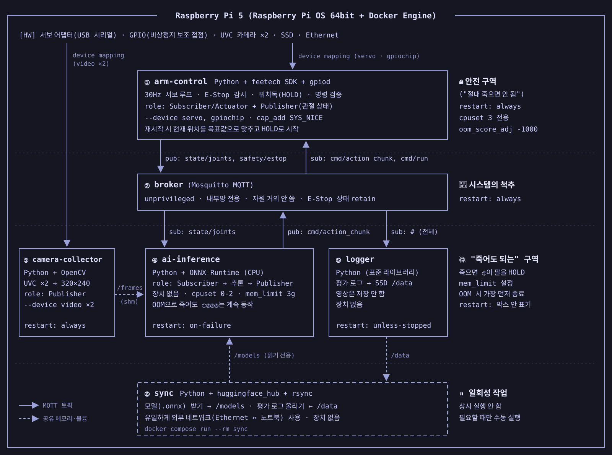

# TeachArm Pi 5 컨테이너 설계 보고서



| 항목      | 내용                                                                                   |
| --------- | -------------------------------------------------------------------------------------- |
| 작성일    | 2026-10-16                                                                             |
| 대상      | 자율 실행(엣지 추론) 단계의 Raspberry Pi 5. 데이터 수집·학습은 노트북·Colab에서 합니다. |
| 근거 문서 | `report/hardware_arm.md`, `report/inference_engine_arm.md`, `report/report_arm.md`     |
| 범위 결정 | Pi 5에서 영상은 저장하지 않습니다. 노트북에서 원격으로 시작·정지하지 않습니다.          |
| 표기      | ※ 는 추정치이거나 실측으로 확인해야 하는 내용입니다.                                   |

---

## 0. 결론

> Pi 5에 **상시 컨테이너 5개 + 일회성 컨테이너 1개**를 둡니다.
> 팔을 직접 움직이는 ① arm-control만 "절대 죽으면 안 되는" 안전 구역에 두고, 비상정지·워치독·명령 검증을 모두 여기에 모읍니다.
> AI 추론(④)이 죽어도 팔은 ①이 현재 자세로 멈춰 세우므로 안전합니다.
> `privileged` 컨테이너는 없습니다. 장치는 필요한 컨테이너에만 `--device`로 넘깁니다.

| # | 컨테이너 | 역할 | 장애 등급 | 장치 권한 | 핵심 라이브러리 | 재시작 |
| --- | --- | --- | --- | --- | --- | --- |
| ① | arm-control | 30Hz 서보 제어, 비상정지 감시, 워치독, 관절 상태 발행 | 죽으면 안 됨 (안전) | 서보 시리얼, GPIO | feetech SDK, gpiod | `always` |
| ② | broker | 메시지 중계 | 죽으면 안 됨 (척추) | 없음 | Mosquitto | `always` |
| ③ | camera-collector | 카메라 2대 수집, 320×240 리사이즈 | 죽어도 됨 | 카메라 2대 | OpenCV | `always` |
| ④ | ai-inference | ACT 추론, 액션 청크 발행 | 죽어도 됨 | 없음 | ONNX Runtime | `on-failure` |
| ⑤ | logger | 평가 로그 기록 | 죽어도 됨 | 없음 | 표준 라이브러리 | `unless-stopped` |
| ⑥ | sync | 모델 받기, 로그 올리기 | 일회성 | 없음 | huggingface_hub, rsync | 수동 실행 |

---

## 1. 분리 기준 ① 안전성 · 장애 영향도

판단 질문: **"동작 중에 이 컨테이너가 죽으면 팔이 위험하게 움직이는가?"**

| 구역 | 컨테이너 | 죽었을 때 | 팔 상태 |
| --- | --- | --- | --- |
| 🔒 안전 | ① arm-control | 서보 명령이 끊김 | 서보가 마지막 위치를 유지합니다. 재시작하면 현재 위치를 목표값으로 맞추고 HOLD로 시작합니다. |
| 🧱 척추 | ② broker | 청크가 들어오지 않음 | ①이 연결 끊김을 감지해 HOLD |
| 💥 죽어도 됨 | ③ camera-collector | 새 프레임 없음 | ④가 추론을 건너뜀 → ①이 청크 소진 후 HOLD |
| 💥 죽어도 됨 | ④ ai-inference | 새 청크 없음 | ①이 청크 소진 후 HOLD |
| 💥 죽어도 됨 | ⑤ logger | 해당 에피소드 로그 유실 | 영향 없음 |

비상정지 스위치의 주 접점은 서보 전원을 물리적으로 끊습니다(`hardware_arm.md` 2장). 따라서 어떤 컨테이너가 죽어도 비상정지는 동작합니다.

**① arm-control의 안전 규칙**

- **HOLD 조건:** 아래 중 하나라도 해당하면 현재 자세를 유지합니다.
  1. 비상정지 GPIO가 눌림
  2. 실행할 청크가 없음
  3. 청크의 관측 시각이 약 500ms보다 오래됨 ※
  4. 브로커 연결이 끊김
- **명령 검증:** AI 출력이 관절 범위나 1스텝당 최대 변화량을 넘으면 잘라냅니다.
- **재개 절차:** 다음 순서로만 다시 움직입니다.
  1. 현재 위치를 읽음
  2. 목표값을 현재 위치로 맞춤
  3. 운영자가 시작 명령을 보냄
  4. 저속으로 복귀
- **기동 순서:** broker에 `depends_on`을 걸지 않습니다. 브로커가 없어도 ①은 HOLD 상태로 먼저 떠 있습니다.

**자원 보호:** Pi 5에는 NPU가 없어 추론과 제어가 같은 CPU를 나눠 씁니다. 그래서 다음처럼 나눕니다.

| 항목 | ① arm-control | ④ ai-inference |
| --- | --- | --- |
| CPU | 코어 3 전용, 실시간 우선순위 | 코어 0~2, 스레드 3개 |
| 메모리 | `oom_score_adj: -1000` (가장 늦게 종료) | `mem_limit: 3g`, `oom_score_adj: 1000` (가장 먼저 종료) |

---

## 2. 분리 기준 ② 하드웨어 접근 권한

원칙: **`privileged`는 쓰지 않습니다.** TeachArm은 USB 시리얼, 카메라, GPIO 같은 문자 장치만 쓰므로, 장치가 필요한 컨테이너에만 해당 장치를 `--device`로 넘깁니다.

| 컨테이너 | 장치 | 추가 권한 | 네트워크 | 볼륨 |
| --- | --- | --- | --- | --- |
| ① arm-control | 서보 시리얼, GPIO 칩 | `SYS_NICE` (실시간 우선순위) | 내부망 | 없음 |
| ② broker | 없음 | 없음 | 내부망 | 없음 |
| ③ camera-collector | 카메라 2대 | 없음 | 내부망 | `/frames` 쓰기 |
| ④ ai-inference | 없음 | 없음 | 내부망 | `/frames`, `/models` 읽기 전용 |
| ⑤ logger | 없음 | 없음 | 내부망 | `/data` 쓰기 |
| ⑥ sync | 없음 | 없음 | **외부(이더넷 ↔ 노트북)** | `/models` 쓰기, `/data` 읽기 |

**공통 설정**

- `cap_drop: [ALL]`, `no-new-privileges`, `read_only: true`
- root가 아닌 사용자로 실행하고, 필요한 그룹(`dialout`, `video`, `gpio`)만 추가합니다.

**장치 경로 고정**

- USB는 다시 꽂으면 번호가 바뀝니다. 그래서 `/dev/serial/by-id/...`, `/dev/v4l/by-id/...` 경로로 넘깁니다.
- GPIO 칩 번호는 커널 버전에 따라 `gpiochip0` 또는 `gpiochip4`입니다. 설치할 때 확인합니다.

**외부 네트워크**

- 외부 네트워크에 붙는 컨테이너는 ⑥ sync 하나뿐입니다.
- ⑥은 필요할 때만 실행하므로, 평소에는 Pi 5의 모든 컨테이너가 외부와 격리되어 있습니다.

```yaml
arm-control:
  devices:
    - /dev/serial/by-id/usb-...-follower:/dev/servo
    - /dev/gpiochip0
  cap_drop: [ALL]
  cap_add: [SYS_NICE]
  cpuset: "3"
  oom_score_adj: -1000
  restart: always

ai-inference:
  cap_drop: [ALL]
  cpuset: "0-2"
  mem_limit: 3g
  oom_score_adj: 1000
  volumes: [frames:/frames:ro, models:/models:ro]
  restart: on-failure
```

---

## 3. 분리 기준 ③ 데이터 라이프사이클 · 역할

| 데이터 | 생성 → 소비 | 주기·크기 | 수명 | 통로 |
| --- | --- | --- | --- | --- |
| 카메라 프레임 | ③ → ④ | 30fps × 2대, 장당 약 230KB | 수십 ms | `/frames` (공유 메모리) |
| 관절 상태 | ① → ④, ⑤ | 30Hz, 수백 B | 수십 ms | MQTT |
| 액션 청크 | ④ → ①, ⑤ | 추론 1회마다 30~50스텝 | 1~1.7초 | MQTT |
| 안전 상태 | ① → 전체 | 이벤트 발생 시 | 해제될 때까지 | MQTT retain |
| 평가 로그 | ⑤ → ⑥ | 에피소드마다, 수 KB~MB | 업로드할 때까지 (일) | SSD `/data` |
| 모델 | ⑥ → ④ | 버전마다 수백 MB | 다음 버전까지 (주) | SSD `/models` |

수명이 다른 데이터는 다른 컨테이너가 맡습니다.

- **실시간 (ms~초):** ①, ③, ④
- **기록 (일):** ⑤
- **배포물 (주):** ⑥

**통로 분리**

- **MQTT:** 작은 메시지만 보냅니다.
- **공유 메모리(tmpfs):** 영상은 초당 약 14MB라서 브로커를 거치지 않고 공유 메모리로 넘깁니다.
- **시각 기준:** 모든 컨테이너가 같은 호스트 시계를 쓰므로, 타임스탬프만으로 "오래된 데이터인지" 판단할 수 있습니다.

**관절 상태는 ①이 발행합니다.**

- 서보 버스는 반이중 방식이라 두 프로세스가 동시에 쓸 수 없습니다.
- 그래서 위치 읽기와 명령 쓰기를 한 컨테이너가 함께 맡습니다.

**토픽**

| 토픽 | 발행 | 구독 | 주기 | QoS / retain |
| --- | --- | --- | --- | --- |
| `state/joints` | ① | ④, ⑤ | 30Hz | 0 |
| `state/arm_mode` (IDLE / RUN / HOLD / ESTOP) | ① | ⑤ | 바뀔 때 | 1, retain |
| `safety/estop` | ① | ④, ⑤ | 이벤트 | 1, retain |
| `cmd/action_chunk` (관측 시각, 모델 버전 포함) | ④ | ①, ⑤ | 추론 1회마다 | 1 |
| `cmd/run` (start / stop / resume) | 운영자 (Pi 5 터미널) | ① | 입력 시 | 1 |
| `eval/result` (성공 / 실패) | 운영자 (Pi 5 터미널) | ⑤ | 에피소드 종료 시 | 1 |
| `health/<컨테이너명>` | ③, ④ | ⑤ | 1Hz | 0 |

**⑤ logger가 남기는 것**

- 에피소드 시작·종료와 성공 여부
- 추론 지연 (p50 / p95)
- 제어 주기 지연
- HOLD·비상정지 이벤트
- 30Hz 관절 궤적

영상은 저장하지 않습니다. 이 로그는 실험 ④(노트북 대비 Pi 5 성공률·지연 비교)의 근거 자료가 됩니다.

---

## 4. 분리 기준 ④ 라이브러리 의존성

| 컨테이너 | 베이스 이미지 | 주요 라이브러리 | 넣지 않는 것 |
| --- | --- | --- | --- |
| ① arm-control | teacharm-base | feetech-servo-sdk, gpiod | LeRobot, PyTorch, OpenCV |
| ② broker | eclipse-mosquitto 공식 이미지 | — | Python |
| ③ camera-collector | teacharm-base | opencv-python-headless, numpy | ONNX Runtime |
| ④ ai-inference | teacharm-base | onnxruntime (aarch64), numpy | PyTorch, LeRobot |
| ⑤ logger | teacharm-base | 표준 라이브러리 (JSONL 기록) | 영상 인코더 |
| ⑥ sync | teacharm-base | huggingface_hub, rsync | 제어·추론 라이브러리 |

- **teacharm-base:** Python slim(arm64), paho-mqtt, 메시지 형식 정의 패키지를 담은 공통 이미지입니다. 모든 컨테이너가 같은 메시지 형식을 쓰도록 맞춥니다. 버전은 lock 파일로 고정합니다.
- **Pi 5에는 PyTorch와 LeRobot을 설치하지 않습니다.** ONNX 변환은 노트북에서 끝냅니다(`inference_engine_arm.md` 6장). 이미지 크기가 커지는 것과 numpy 버전 충돌을 함께 피할 수 있습니다.
- **①은 LeRobot의 모터 드라이버 대신 feetech SDK를 직접 씁니다.** `lerobot`을 import하면 PyTorch까지 함께 설치되기 때문입니다. 안전 구역의 이미지는 가장 작고 단순해야 합니다.

---

## 5. 운영 방법

| 작업 | 방법 |
| --- | --- |
| 전체 실행 | `docker compose up -d`. ①은 HOLD 상태로 시작합니다. |
| 에피소드 시작·재개 | Pi 5 터미널에서 `cmd/run` 발행 (예: `docker compose exec broker mosquitto_pub -t cmd/run -m start`) |
| 정지 | 비상정지 버튼, 또는 `cmd/run`에 `stop` 발행 |
| 성공 여부 기록 | Pi 5 터미널에서 `eval/result` 발행 |
| 모델 교체·로그 업로드 | `docker compose run --rm sync`. 교체한 뒤 ④를 재시작합니다. 모델 교체는 팔이 IDLE일 때만 합니다. |

---

## 6. 확인할 사항

| 항목 | 확인 내용 | 확인 방법 |
| --- | --- | --- |
| 추론 스레드 3개 | 코어 3을 제어용으로 빼도 p95 300ms를 맞추는지 확인합니다(`inference_engine_arm.md` 6.2는 스레드 4개 가정). | 실험 ④에서 스레드 3개 / 4개 지연 비교 |
| 워치독 기준값 | 청크 유효 시간 500ms가 적절한지 확인합니다. ※ | 추론 지연 실측 후 p95 + 여유로 확정 |
| 30Hz 제어 주기 | Python으로 짠 ①이 추론 부하 중에도 33ms 주기를 지키는지 확인합니다. | 30분 연속 동작 중 제어 주기 로그 분석 |
| GPIO 칩 번호 | `gpiochip0` / `gpiochip4` 중 어느 것인지 확인합니다. | 설치 후 `gpioinfo` 확인 |
| 비상정지 해제 후 동작 | 재통전 후 팔이 갑자기 움직이지 않는지 확인합니다(`hardware_arm.md` 6장). | 해제 직후 토크 상태 읽기, 저속 복귀 시험 |

---

### 참고 자료

- [Docker Compose 서비스 설정](https://docs.docker.com/reference/compose-file/services/) — `devices`, `cap_add`, `cpuset`, `mem_limit`, `oom_score_adj`, `restart`
- [Eclipse Mosquitto](https://mosquitto.org/documentation/) — QoS, retained 메시지
- [ONNX Runtime 공식 문서](https://onnxruntime.ai/docs/) — CPU 스레드 설정
- [libgpiod](https://libgpiod.readthedocs.io/) — GPIO 문자 장치 접근
