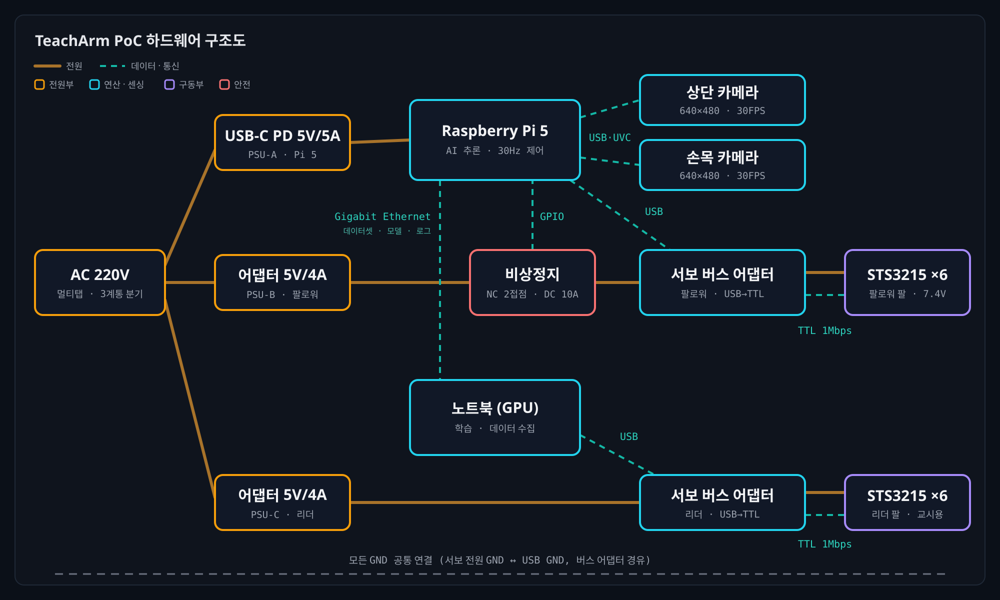

# TeachArm PoC 하드웨어 부품 정리 보고서 (초안)

- 수신: 대표님
- 작성: 하드웨어 파트
- 작성일: 2026-10-14
- 버전: v0.4 (초안) — 부품표 전류를 평균·피크로 구분 (홈페이지 하드웨어 페이지와 값 통일)
- 근거 문서: `PRD/PRD_arm.md`, `report/report_arm.md`
- 표기: ※ 는 데이터시트·판매처 정보가 엇갈리거나 실측이 필요한 값입니다. 발주 전에 확인하겠습니다.

---

## 1. 요약

> PoC는 **셀 1개**(리더 팔 1 + 팔로워 팔 1)로 구성하며, 필요한 부품은 **7종**입니다.
> 실시간 제어는 모두 **유선 USB**로 처리하고, 컴퓨터 간 통신(Pi 5 ↔ 노트북)은 **기가비트 이더넷**으로 데이터셋·모델·로그 전송에만 씁니다. PoC 규모에서는 USB 대역의 일부만 쓰므로 충분합니다(3.2절 ⑦).
> GPIO는 **비상정지 상태 감지용 1개**만 씁니다. PDB, DC-DC 컨버터, 레벨 시프터는 장치별 전원 어댑터 구성이라 필요 없습니다(3.3절).
> 별도 MCU(ESP32-S2 등)는 넣지 않습니다. 서보 버스 어댑터가 USB 변환을 이미 하기 때문에, MCU를 추가하면 펌웨어 개발과 지연 구간만 늘어납니다(4장). MCU는 실제 서비스 단계에서 실시간 제어 계층으로 도입합니다(7장).

| 구분 | 내용 |
| --- | --- |
| 구성 범위 | 셀 1개 (PRD 예산의 3셀 구성은 확장 단계에서 진행) |
| 부품 수 | 7종 (노트북은 보유 장비 활용) |
| 전원 계통 | 3계통: 팔로워 서보 5V, 리더 서보 5V, Raspberry Pi 5 5V/5A (USB-C PD) |
| 통신 방식 | USB 시리얼 1Mbps (서보), USB UVC (카메라), GPIO 디지털 입력 (비상정지 상태), 기가비트 이더넷 (Pi 5 ↔ 노트북·평가 서버) |
| 신규 구매 예상 비용 | 약 114만 원 (PRD 단가 기준, 5장) |

---

## 2. 전체 연결 구성

- 구조도는 **자율 실행 단계** 기준입니다. 데이터 수집 단계의 연결 변경은 아래에 정리했습니다.
- 실선은 전원, 점선은 데이터·통신입니다. 테두리 색은 주황 = 전원부, 청록 = 연산·센싱, 보라 = 구동부, 빨강 = 안전입니다.
- 서보 버스 어댑터와 서보 사이는 3핀 케이블 하나로 전원(5V)과 TTL 신호가 함께 갑니다. 그래서 실선과 점선을 나란히 그렸습니다.

- **데이터 수집 단계:** 리더 팔, 팔로워 팔, 카메라 2대를 모두 노트북에 연결합니다. 노트북에서 30Hz 원격조작과 데이터 기록을 함께 처리합니다.
- **자율 실행(엣지 추론) 단계:** 팔로워 팔과 카메라 2대를 Raspberry Pi 5로 옮겨 연결하고, 리더 팔은 연결하지 않습니다.
- 서보 버스 어댑터의 USB는 **통신 전용**입니다. 서보 전원은 반드시 별도 DC 어댑터로 공급해야 합니다.
- **컴퓨터 간 통신은 기가비트 이더넷(유선)을 씁니다.** Pi 5와 노트북(평가 서버) 사이에서 데이터셋, 학습된 모델, 로그를 주고받습니다.
  - 데이터셋(MP4 + Parquet)과 모델 체크포인트는 수백 MB~수 GB입니다. 이더넷은 1Gbps로 빠르고, 서보 노이즈나 주변 무선 간섭의 영향을 받지 않습니다. 나머지 연결이 모두 유선이라는 설계 원칙과도 맞습니다.
  - Wi-Fi는 현장 무선 환경에 따라 속도가 흔들리고 공유기 설정이 필요합니다. 블루투스는 대용량 전송에 너무 느립니다. ESP-NOW는 ESP32끼리만 쓰는 통신이라 Pi 5·노트북에는 쓸 수 없습니다.
  - Pi 5에는 이더넷 포트가 있습니다. 노트북에 포트가 없으면 USB-C 이더넷 어댑터를 씁니다. 실시간 제어 명령은 이더넷으로 보내지 않습니다.
- 비상정지 스위치는 접점 2개를 씁니다. 주 접점은 서보 전원을 끊고, 보조 접점은 Pi 5에 "비상정지 눌림" 상태를 알립니다. 데이터 수집 단계에서는 노트북에 GPIO가 없으므로 주 접점만 동작합니다.

---

## 3. 부품별 사양

### 3.1 부품 목록 (전압·전류·통신 방식)

| # | 부품 | 수량 | 역할 | 동작 전압 | 평균 전류 | 피크 전류 | 통신 방식 |
| --- | --- | --- | --- | --- | --- | --- | --- |
| 1 | Feetech STS3215 서보 (7.4V 계열) | 12 (팔로워 6, 리더 6) | 관절 구동, 관절 위치·전류 측정 | 5V (정격 4~7.4V, SO-101 표준 공급 5V) | 약 0.3A/개 (동작 중) ※ · 팔로워 1대 약 1.8A | 약 2A/개 (정지 토크, 6V 기준) ※ | TTL 반이중 시리얼, 1Mbps, Feetech STS 프로토콜, ID 기반 데이지 체인 |
| 2 | 서보 버스 어댑터 (Waveshare Bus Servo Adapter (A) 또는 동급) | 2 (팔당 1) | USB ↔ 서보 버스 변환, 서보 전원 분배 | 5V (DC 입력 = 서보 전압, 공식 9~12.6V, 5~8.4V 사용 가능) | 약 1.8A 통과 (팔로워 기준, 자체 소모는 미미) ※ | 약 4A 통과 (이론 최대 12A) ※ | PC 측: USB-C (USB-시리얼) / 서보 측: TTL 반이중 시리얼 |
| 3 | 서보 전원 어댑터 | 2 (팔당 1) | 서보 버스 전원 | 5V DC (입력 AC 220V) | 약 1.8A (팔로워 기준) ※ | 4A (정격 출력, 과전류 보호) | 없음 |
| 4 | Raspberry Pi 5 (8GB, 액티브 쿨러, SSD 포함) | 1 | 엣지 추론, 30Hz 제어 루프 | 5V DC (USB-C PD) | 약 2A (주변기기 포함) ※ | 약 3A (어댑터 최대 5A, USB 주변기기 합계 최대 1.6A) ※ | USB 3.0 ×2 / USB 2.0 ×2, 기가비트 이더넷 (Wi-Fi는 쓰지 않음) |
| 5 | USB UVC 카메라 (상단 고정용 1, 손목 장착용 소형 1) | 2 | 작업 영역 영상, 파지 직전 근접 영상 | 5V (USB 버스 전원) | 약 0.2A/대 ※ | 약 0.3A/대 (켜질 때) ※ | USB 2.0 UVC, 640×480 30fps (MJPEG) |
| 6 | 비상정지 스위치 (머시룸형, NC 접점 2개) | 1 | 팔로워 서보 전원 물리 차단 + 눌림 상태 감지 | 주 접점 5V DC / 보조 접점 3.3V (GPIO) | 주 접점 약 1.8A 통과 / 보조 접점 1mA 미만 | 주 접점 정격 DC 10A 이상 | 주 접점: 없음 (전원선 직렬) / 보조 접점: Pi 5 GPIO 디지털 입력 |
| 7 | 노트북 (GPU 탑재, 보유 장비) | 1 | 원격조작 호스트, ACT 학습, 기준 추론 | 19~20V (자체 어댑터) | 약 5A (GPU 학습 중, 기종마다 다름) ※ | 약 7A (어댑터 정격, 기종마다 다름) ※ | USB, 기가비트 이더넷 (포트 없으면 USB-C 어댑터) |

- 평균 전류는 일반 동작 중, 피크 전류는 순간 최대 기준입니다. 서보 정지 전류와 Pi 5 공급 한도는 데이터시트 값이고, 나머지는 추정치입니다. 조립 후 실측으로 확정합니다(6장).
- 노트북은 제품 전원 계통과 분리된 자체 전원입니다.

### 3.2 부품별 선정 이유와 주의사항

**① Feetech STS3215 서보**
- SO-101은 이 서보 6개로 팔 1대를 구성합니다. LeRobot이 드라이버와 캘리브레이션 도구를 공식 지원하므로 제어 코드를 따로 개발할 필요가 없습니다.
- 12bit 자기식 엔코더(4096 스텝/회전)와 전류값을 읽을 수 있습니다. 관절 상태와 그리퍼 파지 판단에 별도 센서가 필요 없습니다.
- 팔로워는 1/345 기어 6개를 씁니다. 리더는 손으로 움직이기 쉽도록 기어비가 다른 서보 3종을 섞어 씁니다. **리더와 팔로워 서보는 서로 바꿔 끼우면 안 됩니다.**
- 12V 계열 STS3215로 바꾸면 토크가 커지지만, 전원도 12V로 바꿔야 합니다. 7.4V 서보에 12V를 넣으면 서보가 손상됩니다. PoC는 7.4V 계열로 통일합니다.

**② 서보 버스 어댑터**
- 어댑터에는 전압 레귤레이터가 없어 **DC 입력 전압이 그대로 서보에 공급**됩니다. 따라서 전원 어댑터 전압은 서보 사양에 맞춰야 합니다.
- 6개 서보가 한 버스에 연결되어 배선이 단순합니다. 1Mbps 동기 읽기·쓰기로 30Hz 제어 주기(33ms)를 충분히 맞출 수 있습니다.

**③ 서보 전원 어댑터**
- LeRobot 공식 문서 기준으로 7.4V 서보에는 5V 전원을 씁니다.
- 6개 서보가 동시에 모두 멈춰 걸리면(stall) 이론상 약 12A까지 흐를 수 있습니다. 이런 경우는 드물고 소프트웨어 토크 제한을 걸어 두지만, **과전류 보호 기능이 있는 어댑터**를 고르겠습니다.
- 리더 팔은 시연자가 손으로 움직이고 토크를 거의 쓰지 않습니다. 그래서 전류 부담이 작습니다.

**④ Raspberry Pi 5**
- PRD 실험 ④("저가 엣지 장치에서 정책이 돌아가는가")를 검증할 대상 장비입니다.
- 공식 5V 5A 어댑터를 써야 USB 포트로 최대 1.6A를 공급합니다. 일반 3A 어댑터를 쓰면 0.6A로 제한되어 카메라 2대와 서보 어댑터 연결이 불안정해질 수 있습니다.
- CPU 추론이 지속되면 발열로 성능이 떨어지므로 액티브 쿨러가 필수입니다.

**⑤ USB 카메라 2대**
- 상단 카메라는 큐브와 접시의 전체 위치를, 손목 카메라는 파지 직전의 정밀한 위치를 담당합니다. ACT 원 논문과 같은 다중 시점 구성입니다.
- 압축하지 않은 영상은 카메라 1대당 약 221Mbps라 USB 2.0 대역을 넘습니다. 따라서 **MJPEG 출력을 지원하는 모델**을 고르겠습니다.
- 손목 카메라는 무게가 가반하중을 잡아먹으므로 소형 보드형 모듈로 고르고, 케이블이 팔 동작을 방해하지 않도록 배선하겠습니다.

**⑥ 비상정지 스위치**
- 학습된 정책은 예측하지 못한 동작을 할 수 있습니다. 그래서 AI·소프트웨어와 독립된 물리 안전장치가 반드시 필요합니다(PRD 안전 요구사항).
- 팔로워 전원 어댑터와 서보 버스 어댑터 사이 DC 선에 직렬로 연결합니다. 누르면 서보 전원이 끊깁니다.
- 일반 비상정지 스위치는 AC 정격만 크게 표시되어 있어, **DC 정격**을 따로 확인해야 합니다.
- **보조 접점을 Pi 5 GPIO에 연결합니다.** 전원만 끊으면 소프트웨어는 비상정지가 눌린 것을 모릅니다. 그러면 두 가지 문제가 생깁니다.
  - 서보 응답이 없어 통신 오류만 쌓이고, 실패 원인을 "비상정지"로 기록하지 못합니다.
  - 해제하는 순간 그동안 쌓인 목표값으로 팔이 갑자기 움직일 수 있습니다. 서보가 다시 전원을 받을 때 토크가 어떤 상태로 시작하는지는 확인이 필요합니다(※, 6장).
- GPIO로 상태를 읽으면 소프트웨어가 정책을 즉시 멈추고, 해제 후에는 현재 자세에서 다시 시작합니다. Pi 5 GPIO는 3.3V 로직이므로 내부 풀업을 켜고 접점을 GND에 연결합니다. 5V를 넣으면 안 됩니다.
- 추가 비용은 접점이 2개인 스위치를 고르는 것과 점퍼선 정도입니다.

**⑦ 통신 방식: USB만으로 충분한 이유**
- **데이터 양이 적습니다.**
  - 서보: 한 제어 주기(33ms)에 6축 위치를 쓰고 읽는 데이터는 약 100바이트입니다. 1Mbps로 약 1ms면 끝나 주기의 약 3%만 씁니다.
  - 카메라: 2대 모두 MJPEG로 압축하면 각각 수 Mbps(※ 화질 설정에 따라 다름)입니다. USB 2.0(480Mbps)으로도 여유가 많습니다.
- **거리가 짧고 장치가 적습니다.** 모든 장치가 책상 하나 위에 있어 케이블이 1~2m면 되고, 장치는 3~4개뿐입니다. 장거리 배선이나 여러 장치를 묶는 산업용 통신(RS-485, CAN 등)이 필요 없습니다.
- **개발 시간이 거의 들지 않습니다.** LeRobot이 USB 서보 어댑터와 UVC 카메라를 바로 지원합니다. PoC의 목적은 "모방학습으로 작업이 되는가"를 검증하는 것이므로 통신을 직접 개발하지 않습니다.
- **실시간성은 실측으로 확인합니다.** USB는 지연이 항상 일정하다고 보장하지 않습니다. 다만 30Hz 제어는 반응 속도 요구가 느슨한 편이라, PRD의 제어 주기 로그로 지연(p95 40ms 이내)을 확인하는 것으로 충분합니다.

| USB의 약점 | 대응 |
| --- | --- |
| 서보 모터 노이즈로 USB 연결이 끊길 수 있음 | 짧은 케이블과 페라이트 코어를 쓰고, 서보 전원선과 USB 선을 떨어뜨려 배선 |
| 커넥터가 쉽게 빠짐 | 케이블 타이로 케이블 고정 |
| 재부팅하면 장치 이름(`/dev/ttyACM0`/`ttyACM1`)이 바뀌어 리더·팔로워가 뒤바뀔 수 있음 | udev 규칙으로 장치 이름 고정 |
| USB-시리얼 칩의 지연(latency timer) | 제어 주기 로그로 실측 |

### 3.3 전원·신호 변환 부품을 따로 두지 않은 이유

GPIO 외의 전원·신호 부품은 빠뜨린 것이 아니라 **필요 없어서 넣지 않았습니다.**

| 부품 | 상태 | 이유 |
| --- | --- | --- |
| USB-TTL 컨버터 | 사용함 (어댑터 안에 포함) | 서보 버스 어댑터가 이 역할을 합니다. 반이중 TTL 시리얼 변환 회로(74HC126 등)를 따로 만들 필요가 없습니다. |
| PDB (전원 분배 보드) | 의도적으로 제외 | 장치마다 전원 어댑터를 따로 씁니다(팔로워 5V, 리더 5V, Pi 5V 5A). 서보 6개로 가는 전원 분배는 버스 어댑터와 데이지 체인이 맡습니다. 전원 하나로 묶을 때만 PDB가 필요합니다. |
| DC-DC 컨버터 (강압·승압) | 의도적으로 제외 | 어댑터마다 필요한 전압이 바로 나오므로 변환할 곳이 없습니다. 12V 서보로 바꾸거나 전원을 하나로 합치면 그때 필요합니다(예: 12V→5V로 Pi 전원 공급). |
| 레벨 시프터 | 필요 없음 | Pi의 GPIO를 서보 버스에 직접 연결하지 않습니다. 비상정지 접점도 3.3V로만 동작합니다. |

---

## 4. PoC에서 제외한 부품

| 부품 | 제외 이유 | 다시 검토할 시점 |
| --- | --- | --- |
| ESP32-S2 등 별도 MCU | 서보 버스 어댑터가 USB-시리얼 변환을 이미 합니다. 호스트(노트북·Pi 5)가 서보를 직접 제어하는 것이 LeRobot 표준 구성입니다. MCU를 넣으면 펌웨어 개발이 추가되고, 제어 경로에 중간 단계가 생겨 지연이 늘어납니다. | 실제 서비스 단계에서 AI 추론과 실시간 제어를 분리할 때 (7장) |
| NVIDIA Jetson 등 고성능 엣지 장치 | Pi 5에서 목표(추론 p95 300ms)를 달성하는지 먼저 확인합니다. | 실험 ④에서 Pi 5 성공률이 노트북보다 10%p 넘게 떨어질 때 |
| 깊이 카메라, 힘·토크 센서 | MVP 작업(큐브 집어 놓기)은 RGB 카메라 2대와 서보 전류값으로 충분합니다. | 무거운 물체나 접촉이 많은 작업으로 확장할 때 |
| 2·3번째 셀 장비 | PoC는 셀 1개로 기술 타당성만 검증합니다. | PoC 성공 기준(성공률 60%) 달성 후 |
| USB 허브 | 필수는 아닙니다. 노트북에 USB 포트가 4개 미만이면 전원 공급형 허브 1개를 추가합니다. | 데이터 수집 환경 세팅 시 |

---

## 5. 예상 비용 (PoC 1셀)

| 부품 | 단가 | 수량 | 금액 |
| --- | --- | --- | --- |
| SO-101 팔로워 팔 (서보·어댑터·출력 부품 포함) | 450,000 | 1 | 450,000 |
| SO-101 리더 팔 | 350,000 | 1 | 350,000 |
| USB 카메라 | 60,000 | 2 | 120,000 |
| Raspberry Pi 5 (8GB, 쿨러, SSD, 전원) | 200,000 | 1 | 200,000 |
| 비상정지 스위치(접점 2개) + 배선 자재 ※ | 20,000 | 1 | 20,000 |
| 노트북 | 보유 장비 | - | 0 |
| **합계** | | | **약 1,140,000** |

- 단가는 PRD 예산표 기준입니다. 비상정지 스위치 단가는 이 보고서의 가정입니다.
- 서보 전원 어댑터가 팔 키트에 포함되는지 판매처마다 다릅니다. 미포함이면 개당 1~2만 원이 추가됩니다(※ 가정).

---

## 6. 발주 전 확인할 사항

| 항목 | 확인 내용 | 확인 방법 |
| --- | --- | --- |
| STS3215 전류값 | 판매처는 6V 기준 값만 표기합니다(정지 전류 약 2A). 5V 공급 시 실제 전류는 확인이 필요합니다. | 원본 데이터시트 확인 + 조립 후 전원 어댑터 출력 전류 실측 |
| 서보 전원 어댑터 용량 | 5V 4A로 팔로워 6축 동시 동작이 충분한지 확인합니다. | 시연 동작 중 최대 전류 측정, 부족하면 6A로 상향 |
| 서보 버전 혼입 여부 | 키트에 7.4V/12V 서보가 섞여 오지 않았는지 확인합니다. | 서보 라벨(C001 등) 확인 후 조립 |
| Pi 5 USB 전력 | 카메라 2대 + 서보 어댑터 동시 연결 시 안정적인지 확인합니다. | 30분 연속 동작 시험, 장치 끊김 로그 확인 |
| 카메라 MJPEG 지원 | 640×480 30fps를 MJPEG로 출력하는지 확인합니다. | 구매 전 사양표 확인, 수령 후 `v4l2-ctl`로 지원 포맷 확인 |
| 비상정지 DC 정격 | 주 접점이 DC 5V·최대 전류를 견디고, 접점이 2개인지 확인합니다. | 사양표의 DC 정격·접점 구성 확인 |
| 비상정지 GPIO 감지 | 버튼을 누르면 소프트웨어가 정책을 즉시 멈추는지 확인합니다. | 동작 중 비상정지 10회 시험, 로그에 "비상정지" 기록 확인 |
| 서보 재통전 시 토크 상태 | 비상정지 해제 후 팔이 갑자기 움직이지 않는지 확인합니다. | 해제 직후 서보 토크 상태 읽기, 저속 복귀 동작 시험 |
| USB 제어 지연 | 제어 주기 지연이 p95 40ms 이내인지 확인합니다. | 30분 연속 원격조작 중 제어 주기 로그 분석 |

---

## 7. 실제 서비스 단계 확장 방향

PoC는 "책상 위, 사람이 지켜보는 환경"을 전제로 **"AI가 작업을 해내는가"만 검증**하려고 통신과 전원을 가장 단순하게 구성했습니다. 실제 현장은 **24시간 가동, 전기 노이즈, 사람이 없는 상황**을 견뎌야 하므로 아래처럼 발전시킵니다.

| 영역 | PoC | 실제 서비스 | 바꾸는 이유 |
| --- | --- | --- | --- |
| 서보 통신 | USB → TTL 시리얼 | **RS-485 또는 CAN** (차동 신호) | 노이즈에 강하고 배선을 길게 뺄 수 있습니다. 산업 현장의 표준입니다. |
| 카메라 | USB UVC | **GigE Vision** 또는 잠금형 USB3 산업용 카메라 | 케이블이 길어도 되고, 커넥터가 빠지지 않으며, 여러 카메라의 촬영 시점을 맞출 수 있습니다. |
| 제어 구조 | 호스트(Pi 5)가 서보를 직접 제어 | **호스트(AI 추론) + 전용 MCU(실시간 제어)로 분리** | MCU가 워치독 역할을 합니다. AI 쪽이 멈추거나 느려져도 MCU가 팔을 안전하게 정지시킵니다. ESP32·STM32 같은 MCU는 이 단계에서 도입합니다. |
| 전원 | 장치별 개별 어댑터 3개 | **24V 산업용 전원 1개 + PDB + DC-DC 컨버터**, 계통별 퓨즈 | 배선을 정리하고, 한 계통에 고장이 나도 다른 곳으로 번지지 않게 막습니다. 패널 안에 설치하기도 쉽습니다. |
| 안전 | 비상정지 스위치 + GPIO 상태 감지 | **안전 릴레이**, 이중 접점 비상정지, 전류 기반 충돌 감지, 펜스나 라이트 커튼 | 사람과 같은 공간에서 일하려면 안전 규격(ISO 10218 등) 대응이 필요합니다. |
| 연산 장치 | Raspberry Pi 5 | 실험 ④ 결과로 결정 (Pi 5 유지 또는 **Jetson Orin**) | 추론 속도가 성공률에 영향을 주면 GPU 엣지로 올립니다. |
| 로봇 본체 | SO-101 (취미용 서보, 3D 프린팅) | 산업용 액추에이터와 금속 구조 | 가반하중, 반복 정밀도, 수명을 확보합니다. |
| 보드 | 시판 어댑터 조합 | **자체 PCB** (MCU, 서보 통신, 전원을 하나로 통합) | 양산 원가를 낮추고, 조립하기 쉽고, 품질을 일정하게 유지합니다. |

정리하면 실제 서비스에서는 **통신은 노이즈에 강하게(RS-485, CAN), 제어는 2단으로(AI + MCU), 전원은 하나로 묶어 보호하는 방향(PDB, 컨버터, 퓨즈)**으로 바꿉니다. 구체적인 부품 선정과 비용은 PoC 결과가 나온 뒤 별도 보고서로 올리겠습니다.

---

## 8. 결론 및 요청 사항

- PoC 하드웨어는 **SO-101 팔 2대(서보·어댑터 포함), 서보 전원 2개, Raspberry Pi 5, USB 카메라 2대, 비상정지 스위치(GPIO 상태 감지 포함)**로 구성합니다. 신규 구매 비용은 약 114만 원입니다.
- 모든 실시간 제어 경로가 유선 USB라서 네트워크 상태와 상관없이 30Hz 제어가 가능합니다. PoC 규모에서는 USB 대역의 일부만 쓰므로 별도 산업용 통신이나 PDB·컨버터가 필요 없습니다.
- 실제 서비스 단계에서는 RS-485/CAN 통신, AI + MCU 2단 제어, 통합 전원(PDB·컨버터·퓨즈)으로 확장합니다.
- **요청:** 위 구성으로 1셀 부품 발주를 승인해 주시면, 6장 항목을 확인한 뒤 바로 주문하겠습니다.

---

### 참고 자료

- [LeRobot SO-101 공식 문서](https://huggingface.co/docs/lerobot/so101) — 서보 버전별 전원(7.4V 서보 → 5V, 12V 서보 → 12V), USB는 통신 전용
- [Waveshare Bus Servo Adapter (A) 문서](https://docs.waveshare.com/Bus_Servo_Adapter_A) — 입력 전압, 레귤레이터 없음
- [STS3215 데이터시트(번역본)](https://core-electronics.com.au/attachments/uploads/sts3215-smart-servo-datasheet-translated.pdf), [Core Electronics 제품 페이지](https://core-electronics.com.au/catalog/product/view/sku/CE09383) — 전압 범위, 무부하·정지 전류
