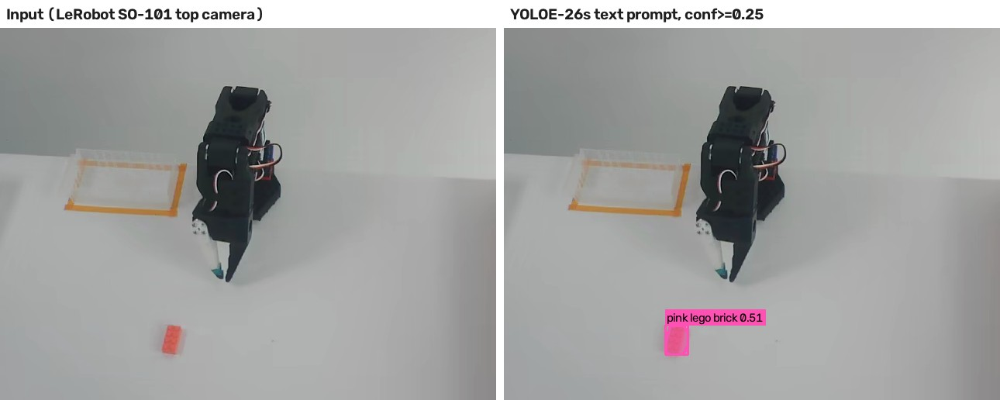
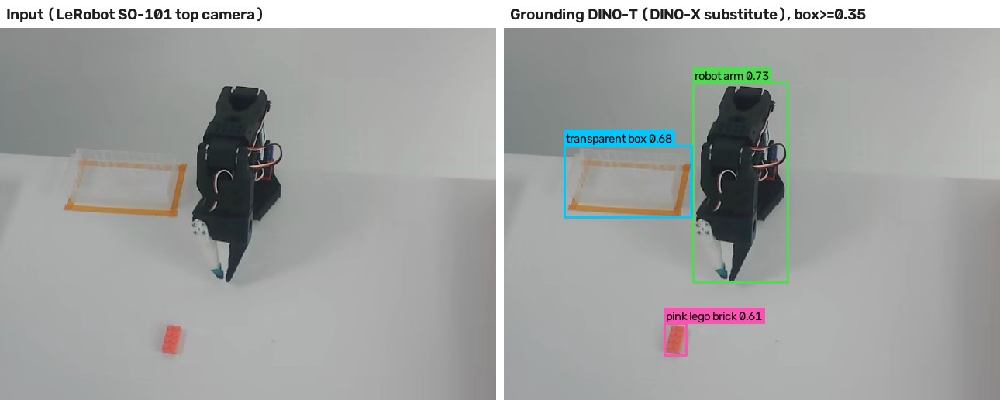
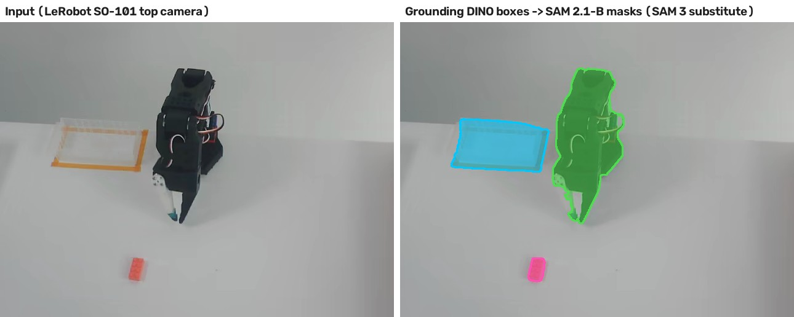
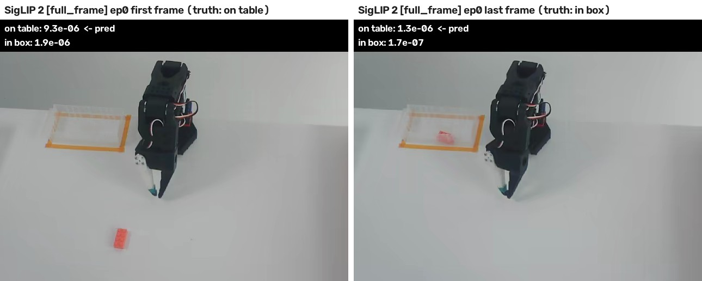
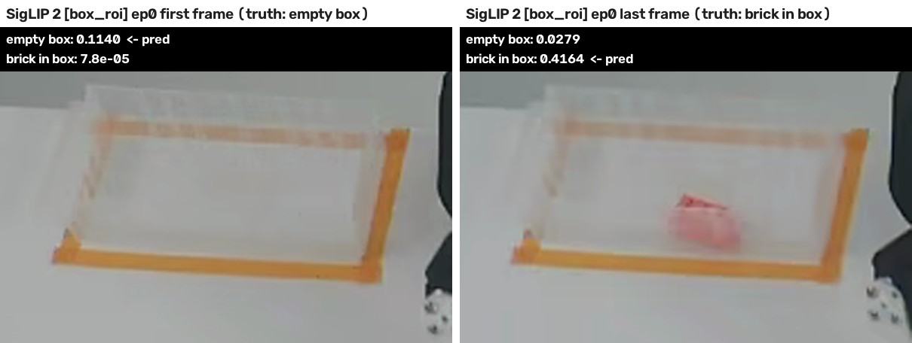
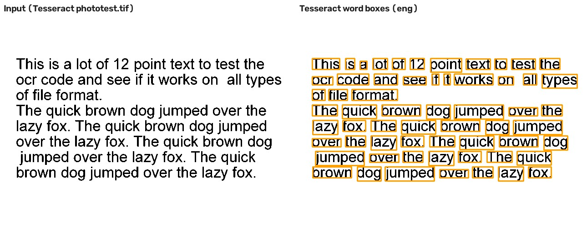
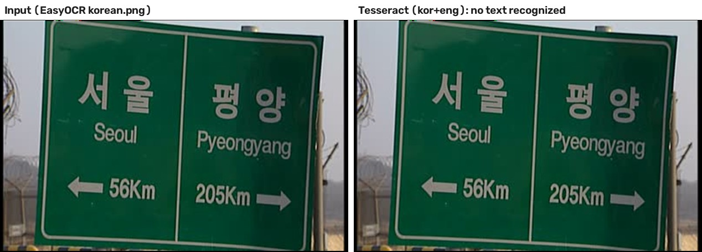
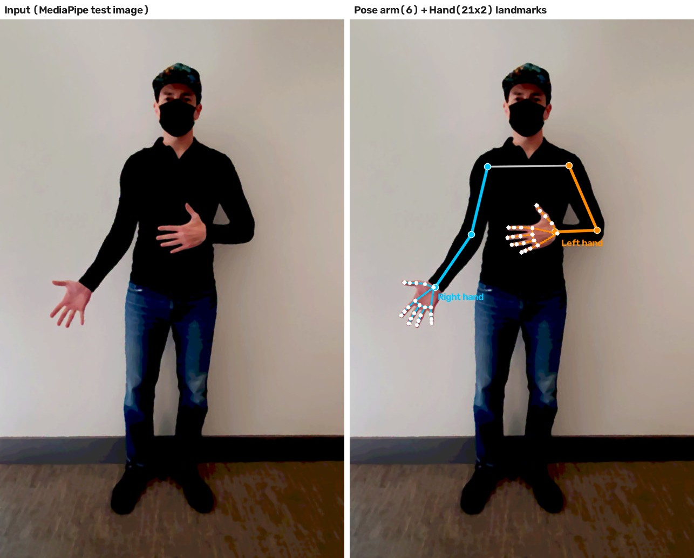

# TeachArm 비전 모델 도입 검토 보고서

| 항목      | 내용                                                                                                                            |
| --------- | ------------------------------------------------------------------------------------------------------------------------------- |
| 수신      | 대표이사                                                                                                                        |
| 작성      | CTO                                                                                                                             |
| 작성일    | 2026-10-12                                                                                                                      |
| 검토 대상 | YOLOE, DINO-X, SAM 3, SigLIP, OCR(Tesseract), MediaPipe                                                                         |
| 근거 자료 | 실험 코드 `code/model_comparison/`, 실측 결과 `report/model_comparison/results.json`·`latency.json`, 결과 이미지 `images/model_comparison/*.jpg` |

---

## 0. 요약

**결론**

| 구분              | 모델                | 용도                                                       | 핵심 근거 (실측)                                                                                 |
| ----------------- | ------------------- | ---------------------------------------------------------- | ------------------------------------------------------------------------------------------------ |
| **도입 (1순위)**  | **MediaPipe**       | 실험 ③ 손 추적 원격조작 (PRD 필수 항목)                    | 6개 중 유일하게 오프라인·실시간으로 손 21점을 출력. CPU 손 15.3 ms, Apache-2.0, 무료 |
| **도입 (2순위)**  | **YOLOE-26s**       | 큐브 탐지 보조 모듈 (데이터 QA·판정 보조, 오프라인 사후 처리) | 라벨링 없이 블록 1순위 박스 정답률 92%, CPU 161 ms, 기존 YOLO 설계안과 같은 도구 체계        |
| 보류              | DINO-X              | -                                                          | 정확도는 최상위권이나 클라우드 전용·유료 호출·인터넷 필수                                        |
| 보류              | SAM 3               | -                                                          | 848M 파라미터·승인제 가중치. MVP는 박스 수준이면 충분                                            |
| 보류              | SigLIP              | -                                                          | 위치를 출력하지 않음. 상자 영역을 잘라 줘야 판정 정확도 96% (전체 화면 49%)                      |
| 보류              | OCR (Tesseract)     | -                                                          | MVP 작업(큐브·접시)에 글자가 없음. 사진 속 한글 표지판 인식 실패                                 |

**이유 (세 줄)**

1. TeachArm 문서(PRD, 객체 탐지 설계안)에 적힌 비전 용도는 **손 추적 원격조작**과 **큐브 탐지 보조** 두 가지뿐입니다. 이 두 자리를 채우는 모델만 도입합니다.
2. 손 추적은 MediaPipe 외에 오프라인·실시간으로 손 키포인트를 내는 후보가 없습니다. 큐브 탐지는 3개 후보 중 YOLOE가 가중 점수 4.30으로 1위입니다(SAM 3 3.80, DINO-X 3.00, 4.3절).
3. 두 모델 모두 무료이고 노트북 CPU에서 동작하므로 추가 비용이 들지 않으며, 엣지 장치(Raspberry Pi 5) 방향과도 맞습니다.

---

## 1. 검토 배경과 평가 방법

### 1.1 TeachArm에서 비전 모델이 쓰이는 곳

ACT 정책은 카메라 영상을 그대로 입력받는 엔드투엔드 모델이라 **정책 자체에는 별도 비전 모델이 필요 없습니다**(`report/object_detection.md` 0장). 비전 모델이 들어갈 자리는 아래 두 곳뿐입니다.

| 요구 | 출처                                                                                      | 필요한 출력           | 조건                                     |
| ---- | ----------------------------------------------------------------------------------------- | --------------------- | ---------------------------------------- |
| R1   | PRD 실험 ③ 원격조작 비교군: "MediaPipe Hands (21개 손 랜드마크) + 역기구학"               | 손 키포인트 21점      | 30Hz 원격조작 루프 안에서 **실시간**     |
| R2   | 객체 탐지 설계안: 데이터 QA, 인식 실패 판정 보조, 성공 판정 보조, 큐브 위치 교차 확인     | 큐브 위치(박스)       | 녹화 영상을 노트북에서 **사후 처리**     |

공통 조건: 엣지 vs 클라우드 보고서(`report/report_arm.md`)에서 엣지(로컬) 처리를 채택했으므로 **오프라인 실행**과 **반복 비용 0**을 우선합니다.

### 1.2 실험 데이터: TeachArm과 같은 구성의 공식 공개 데이터

자체 시연 데이터는 아직 없으므로, Hugging Face의 LeRobot 공식 데이터셋 **`lerobot/svla_so101_pickplace`** (Apache-2.0, 리비전 `f641879`)를 대리 데이터로 썼습니다.

| 항목      | TeachArm (PRD)                         | 대리 데이터                                  |
| --------- | -------------------------------------- | -------------------------------------------- |
| 로봇      | SO-101                                 | SO-101                                       |
| 카메라    | 상단 + 손목, 640×480, 30fps            | 상단(`up`) + 측면, 640×480, 30fps            |
| 작업      | 큐브를 집어 접시에 놓기                | 분홍 레고 블록을 집어 투명 상자에 넣기       |
| 시연 수   | 50개 (MVP 기준)                        | 50개                                         |

- 각 시연의 **첫 프레임**(블록이 책상 위)과 **마지막 프레임**(블록이 상자 안)을 뽑아 총 100장을 만들었습니다.
- 첫 프레임의 블록 정답 박스는 색(HSV) 임계값으로 자동 생성했고, 50장 모두 블록에 정확히 박스가 잡힌 것을 눈으로 확인했습니다.
- OCR과 손 추적은 이 데이터에 글자·사람 손이 없어서, 각 프로젝트의 **공식 저장소 테스트 이미지**를 썼습니다(1.5 출처표).

### 1.3 측정 지표

| 모델                 | 대리 과제                                     | 지표                                                                                  |
| -------------------- | --------------------------------------------- | ------------------------------------------------------------------------------------- |
| YOLOE, DINO-X        | 첫 프레임 50장에서 "pink lego brick" 찾기     | ① 기본 임계값 재현율 ② **1순위 박스 정답률**(장면에 블록이 1개뿐이므로 실사용 규칙) — 정답: IoU ≥ 0.5 |
| SAM 3                | 위와 같은 블록의 윤곽 마스크                  | 정답 마스크와의 IoU                                                                   |
| SigLIP               | 100장을 "책상 위 / 상자 안"으로 분류          | 정확도                                                                                |
| OCR                  | 영문 문서 / 한글 도로표지판 사진              | 문자 오류율(CER, 0 = 완벽, 1 = 전부 틀림)                                             |
| MediaPipe            | 공식 샘플 3장의 손                            | 보이는 손 6개 중 검출 수                                                              |
| 공통                 | -                                             | CPU 지연시간(배치 1), 모델 크기, 파라미터 수                                          |

실행 환경: Apple M4 노트북, **CPU만 사용**(GPU 미사용, PyTorch 4스레드), Python 3.14. 엣지 장치와 조건을 맞추려고 GPU를 쓰지 않았습니다. 지연시간은 6개 모델을 한 프로세스에 올려 번갈아 3라운드 측정한 중앙값입니다(`latency.json`). 같은 노트북에서도 발열 상태에 따라 단독 측정값이 최대 2배까지 달랐기 때문입니다.

### 1.4 직접 실행하지 못한 두 모델 (대체 실행)

| 모델   | 직접 실행 못 한 이유                                                                   | 대체 실행                                                                                       |
| ------ | -------------------------------------------------------------------------------------- | ----------------------------------------------------------------------------------------------- |
| DINO-X | 가중치 비공개, 클라우드 API 전용. API 토큰 신청 필요, 추가 호출은 유료 구매(공식 README) | 같은 IDEA Research의 공개 전작 **Grounding DINO Tiny** (Apache-2.0)                            |
| SAM 3  | Hugging Face 체크포인트가 승인제(gated: manual). 계정 승인 전에는 다운로드 불가         | SAM 3 이전의 표준 조합 **Grounded-SAM 2** (Grounding DINO 박스 → SAM 2.1-B 마스크)             |

대체 모델의 결과는 해당 모델 자체의 성능이 아닙니다. DINO-X는 공식 벤치마크에서 Grounding DINO 계열보다 높은 점수를 발표했으므로(2.2절), 대체 결과는 **하한선**으로 해석합니다. 직접 실행할 수 없다는 사실 자체도 도입 조건(비용·접근성)에 반영했습니다.

### 1.5 재현 방법

```bash
python code/model_comparison/prepare_data.py   # 공식 데이터 다운로드(고정 리비전) + 프레임·정답 생성
python code/model_comparison/run_models.py     # 6개 모델 실행 → 결과 이미지 + results.json
python code/model_comparison/bench_latency.py  # 지연시간 교차 측정 → latency.json
```

| 데이터                      | 출처 (고정 리비전)                                                                 |
| --------------------------- | ---------------------------------------------------------------------------------- |
| SO-101 시연 영상            | huggingface.co/datasets/lerobot/svla_so101_pickplace @ `f641879`                    |
| 영문 문서 + 정답 텍스트     | github.com/tesseract-ocr/test `testing/phototest.tif`, `phototest.gold.txt` @ `232ff18` |
| 한글 도로표지판 사진        | github.com/JaidedAI/EasyOCR `examples/korean.png` @ `363afb1`                       |
| 손·전신 사진 3장            | MediaPipe 공식 테스트 이미지 (google-ai-edge/mediapipe `external_files.bzl` 등록본), mediapipe-samples 예제 이미지 |

---

## 2. 모델별 설명·기능·장단점·사용 예시

### 2.1 YOLOE — 글로 지시하면 실시간으로 찾는 탐지기

**설명**: 칭화대(THU-MIG)가 2025년 3월 공개한 개방형 어휘(open-vocabulary) 탐지·분할 모델입니다(arXiv 2503.07465). COCO로 학습한 기존 YOLO는 80개 클래스만 찾지만, YOLOE는 "pink lego brick"처럼 **글로 적은 대상을 추가 학습 없이** 찾습니다. Ultralytics 패키지에 통합되어 있고, 이번 실험은 최신 YOLOE-26s를 썼습니다.

**주요 기능**

- 텍스트 프롬프트: 찾을 물체 이름을 글로 지정
- 시각 프롬프트: 예시 이미지의 박스로 지정
- 프롬프트 없는 모드: 내장 어휘로 화면의 모든 물체 탐지
- 박스와 분할 마스크를 동시에 출력
- 일반 YOLO와 같은 방식으로 파인튜닝 가능

**사용 예시**



`[SO-101 상단 카메라 프레임] → [YOLOE: "pink lego brick" 박스+마스크]`
세 대상(블록·투명 상자·로봇팔)을 글로 지정했고, 기본 임계값 0.25에서는 **블록만** 점수 0.51로 찾았습니다. 투명 상자와 로봇팔은 임계값을 넘지 못했습니다.
시연 50장 기준으로는 아래와 같습니다.

- **1순위 박스 정답률 92%** (46/50)
- 기본 임계값 재현율 58%, 오탐 12건: 블록을 맞게 찾아도 점수가 0.25보다 낮은 경우가 17장 있었습니다.
- CPU 161 ms/장, 파라미터 15.3M, 가중치 29.6MB

**장단점**

| 장점                                                                                   | 단점                                                                                                           |
| -------------------------------------------------------------------------------------- | -------------------------------------------------------------------------------------------------------------- |
| 6개 중 탐지 모델로는 가장 빠름: CPU 161 ms (Grounding DINO 대비 약 25배)  | 점수가 낮게 나와 기본 임계값을 그대로 쓰면 재현율 58%                                                          |
| 라벨링 없이 시작 가능 (1순위 박스 정답률 92%)                                          | 투명 물체(상자)·흔한 물체(로봇팔)를 기본 임계값에서 놓침                                                        |
| 공식 발표: LVIS에서 YOLOE-v8-S가 YOLO-Worldv2-S보다 AP 3.5 높고 추론 1.4배 빠름        | 라이선스 AGPL-3.0: 제품에 넣어 배포하면 소스 공개 또는 Ultralytics 유료 라이선스 필요 (사내 도구는 해당 없음, 법무 확인 권장) |
| 기존 설계안(YOLO26n)과 같은 Ultralytics 도구라 학습·배포 절차를 그대로 재사용         | 처음 실행 시 텍스트 인코더(MobileCLIP2, 242MB)를 추가로 내려받음                                               |

### 2.2 DINO-X — 정확도 최상위의 클라우드 탐지 API

**설명**: IDEA Research가 2024년 11월 발표한 범용 객체 인식 모델입니다(arXiv 2411.14347). Grounding DINO 1.5/1.6의 후속작이며, **가중치는 공개하지 않고 클라우드 API로만** 제공합니다. 처음 쓸 때 API 토큰을 신청해야 하고, 추가 호출은 구매해야 합니다(공식 README).

**주요 기능**

- 텍스트·시각 프롬프트 기반 개방형 탐지와 분할
- 문구-영역 연결(phrase grounding)
- 시각 프롬프트 기반 개수 세기
- 포즈 키포인트, 영역 설명 문장(caption) 출력
- 프롬프트 없는 전체 물체 탐지

**공식 발표 성능** (README): DINO-X Pro 제로샷 COCO 56.0 AP, LVIS-minival 59.8 AP, LVIS-val 52.4 AP.

**사용 예시 (대체 실행: Grounding DINO Tiny)**



`[SO-101 상단 카메라 프레임] → [Grounding DINO: 블록·투명 상자·로봇팔 박스]`
같은 프레임, 같은 문구, 공식 데모 기본 임계값(박스 0.35)에서 **세 대상을 모두** 찾았습니다(블록 0.61, 상자 0.68, 로봇팔 0.73).
시연 50장 기준으로는 아래와 같습니다.

- 1순위 박스 정답률 **100%**, 기본 임계값 재현율 **100%**, 오탐 0건
- CPU 4,035 ms/장, 파라미터 172.3M

**장단점**

| 장점                                                                         | 단점                                                                                    |
| ---------------------------------------------------------------------------- | --------------------------------------------------------------------------------------- |
| 대체 모델조차 대리 과제 정확도 100%, 오탐 0                                  | DINO-X 본체는 클라우드 전용: 인터넷 상시 필요, 영상이 외부 서버로 전송됨               |
| 투명 상자 같은 어려운 대상도 찾음                                            | 호출량에 따라 비용이 계속 발생 (엣지 채택 방침과 상충)                                  |
| 탐지·분할·포즈·캡션을 API 하나로 제공                                        | 오프라인 대체(Grounding DINO)도 CPU 4,035 ms로 YOLOE보다 약 25배 느림   |
| 공개 전작 Grounding DINO는 Apache-2.0                                        | 가중치 비공개라 파인튜닝·엣지 이식 불가                                                 |

### 2.3 SAM 3 — 글로 지시하면 해당 물체를 전부 윤곽까지 따는 모델

**설명**: Meta가 2025년 11월 공개한 "Segment Anything with Concepts"입니다. 이전 SAM 1/2는 사람이 점·박스로 찍어 줘야 분할했지만, SAM 3는 **짧은 문구나 예시 이미지만으로 해당 개념의 모든 객체를 찾아 분할하고, 영상에서 추적**합니다. 파라미터는 848M이고, 공식 발표로 27만 개 개념을 담은 SA-Co 벤치마크에서 사람 성능의 75~80%를 냅니다(공식 README). 2026년 3월 개선판 SAM 3.1이 나왔습니다.

**주요 기능**

- 텍스트·예시 이미지 기반 개념 분할 (모든 인스턴스)
- 점·박스·마스크 기반 대화형 분할 (SAM 2 기능 포함)
- 영상 객체 추적
- "흰 옷 선수 / 빨간 옷 선수"처럼 비슷한 문구를 구분하는 presence token

**사용 예시 (대체 실행: Grounding DINO 박스 → SAM 2.1-B)**



`[SO-101 상단 카메라 프레임] → [블록·상자·로봇팔의 픽셀 단위 윤곽 마스크]`
박스보다 정밀한 윤곽을 얻습니다. 로봇팔 측면의 케이블 고리와 투명 상자의 비스듬한 사각형 윤곽까지 따라갑니다.
시연 50장 기준으로는 아래와 같습니다.

- 블록 마스크와 정답 마스크의 IoU 평균 **0.607**, 50장 모두 0.5 이상
- 정답 마스크는 채도가 높은 면만 잡는 색 임계값으로 만들어서, 블록의 옆면·하이라이트까지 포함하는 SAM 마스크보다 작습니다. IoU 0.6은 이 기준 차이를 포함한 값입니다.
- SAM 단계만 CPU 2,344 ms/장 (탐지 단계 별도)

**장단점**

| 장점                                                                 | 단점                                                                                      |
| -------------------------------------------------------------------- | ----------------------------------------------------------------------------------------- |
| 박스가 아닌 픽셀 단위 윤곽 → 파지점·자세 분석, 마스크 라벨 자동 생성 | 848M 파라미터로 무거움 (대체 조합도 장당 수 초)                                           |
| 탐지·분할·추적을 모델 하나로 처리                                    | 체크포인트 승인제: 계정 승인 전에는 사용 불가                                             |
| SAM License: 무료(royalty-free), 상업적 이용 제한 조항 없음 (수출 통제·제재 관련 조건 있음) | TeachArm MVP의 판정 기준은 박스·ROI면 충분해서 윤곽 정밀도가 성과로 이어지지 않음         |

### 2.4 SigLIP — 이미지와 문장을 비교해 점수를 매기는 모델

**설명**: Google이 2023년 발표한 이미지-텍스트 사전학습 모델(arXiv 2303.15343)이고, 이번 실험은 2025년 2월의 개선판 **SigLIP 2**(arXiv 2502.14786)를 썼습니다. 이미지와 문장을 같은 공간에 놓고 **"이 사진이 이 문장과 얼마나 맞는가"** 를 점수로 냅니다. 위치는 출력하지 않습니다. VLM의 이미지 인코더로도 쓰입니다. 예를 들어 LeRobot의 SmolVLA는 SmolVLM2를 백본으로 쓰는데, SmolVLM2의 이미지 인코더가 SigLIP입니다(공식 모델 카드).

**주요 기능**

- 제로샷 이미지 분류 (후보 문장 중 가장 맞는 것 선택)
- 이미지-텍스트 검색
- VLM·VLA의 비전 인코더

**사용 예시 ①: 전체 화면**



`[시연 첫/마지막 프레임] + ["책상 위 블록" / "상자 안 블록"] → [문장별 확률]`
블록이 약 15×30픽셀(화면의 0.15%)이라 224×224로 줄이면 거의 사라집니다. 100장 중 **99장을 "책상 위"로 답했고 정확도는 49%**로, 찍는 수준입니다.

**사용 예시 ②: 상자 영역만 잘라서 판정**



`[상자 영역 200×140 크롭] + ["빈 상자" / "블록이 든 상자"] → [문장별 확률]`
카메라가 고정이라 상자 위치는 50개 시연에서 같습니다. 이 영역만 잘라 주자 **정확도 96%**(빈 상자 100%, 블록 든 상자 92%)로 올랐습니다. 틀린 4장(ep01·14·29·37의 마지막 프레임)은 블록이 상자 안에 또렷이 보이는데도 "빈 상자"로 답했습니다. 왜 틀렸는지 설명하기 어려운 오류라, 쓰더라도 사람 검수를 붙여야 합니다.
CPU 213 ms/장, 파라미터 375.2M.

**장단점**

| 장점                                                                           | 단점                                                                    |
| ------------------------------------------------------------------------------ | ----------------------------------------------------------------------- |
| 학습 없이 문장만 바꿔 다양한 상태 판정 가능                                    | 위치(박스)를 출력하지 않음 → 객체 탐지 설계안의 4개 용도 중 1개만 수행 |
| ROI를 주면 성공 판정 정확도 96%                                                | 작은 물체는 전체 화면에서 판정 불가 (정확도 49%)                         |
| Apache-2.0, VLA(SmolVLA 등) 백본이라 향후 정책 고도화 시 자연스럽게 쓰임       | 확률값이 독립 시그모이드라 절대값이 작아 임계값 설정이 까다로움         |

### 2.5 OCR (Tesseract) — 이미지 속 글자를 텍스트로

**설명**: OCR은 이미지 속 글자를 텍스트로 바꾸는 기술입니다. 대표 오픈소스 엔진인 **Tesseract 5.5.2**(LSTM 기반, Apache-2.0)로 실험했습니다. 설치본 기준으로 163개 언어·문자 데이터를 지원합니다.

**주요 기능**

- 인쇄 문서 글자 인식
- 단어별 위치 박스와 신뢰도 출력
- 다국어 동시 인식(`kor+eng`)

**사용 예시 ①: 영문 문서**



`[Tesseract 공식 테스트 문서] → [단어별 박스 + 텍스트]`
공식 정답 텍스트와 비교해 **문자 오류율 0.0**으로 완벽하게 읽었습니다. CPU 198 ms/장.

**사용 예시 ②: 한글 도로표지판 사진**



`[EasyOCR 공식 예제 사진] → [인식 결과 없음]`
정답은 "서울 Seoul 56Km 평양 Pyeongyang 205Km"이지만 `kor+eng` 설정에서 **아무 글자도 출력하지 않았습니다**(문자 오류율 1.0). 흑백 반전 전처리(흰 글씨를 검은 글씨로)를 해도 문자 오류율 1.0이었습니다. Tesseract는 깨끗한 문서용 엔진이라, 배경이 복잡한 사진 속 글자(scene text)에는 약합니다.

**장단점**

| 장점                                       | 단점                                                                      |
| ------------------------------------------ | ------------------------------------------------------------------------- |
| 문서 인식은 완벽 (CER 0.0), 가볍고 무료    | 사진 속 글자는 인식 실패 (CER 1.0) → 현장 라벨 읽기에는 다른 엔진 필요   |
| 언어 데이터 5.5MB(영·한), 완전 오프라인    | TeachArm MVP 작업(큐브·접시)에는 읽을 글자가 없음                         |

### 2.6 MediaPipe — 손과 몸의 관절점을 실시간으로

**설명**: Google의 온디바이스 비전 프레임워크입니다. **Hand Landmarker**는 손마다 21개 관절점(x, y, z)과 왼손/오른손을, **Pose Landmarker**는 몸 33개 관절점을 출력합니다. Apache-2.0이고 CPU에서 실시간으로 동작합니다. 이번에 쓴 1.1.0 버전은 예전 `mp.solutions` API가 없어 Tasks API로 작성했습니다(`code/mediapipe_arm_hand_landmarks.py`).

**주요 기능**

- 손 21점 + 좌우 판별 (최대 손 개수 지정)
- 몸 33점 (이번에는 어깨·팔꿈치·손목 6점만 사용)
- 이미지·영상·실시간 스트림 모드

**사용 예시**



`[MediaPipe 공식 테스트 사진] → [팔 6점 + 양손 21점×2]`
왼쪽(주황)·오른쪽(하늘색)으로 팔과 손의 짝을 맞춰 그렸습니다.
공식 샘플 3장 기준으로는 아래와 같습니다.

- **보이는 손 6개 중 4개** 검출. 전신 사진(`pose.jpg`)의 작은 손 2개를 놓쳤습니다.
- 팔꿈치→손목 방향으로 손 위치를 추정해 잘라 다시 찾는 보완을 넣으면 **6개 모두** 검출했습니다.
- CPU 손 15.3 ms + 팔 22.1 ms

**장단점**

| 장점                                                                         | 단점                                                                       |
| ---------------------------------------------------------------------------- | -------------------------------------------------------------------------- |
| 6개 중 가장 빠름: 손 15.3 ms → 30Hz 원격조작 루프(33ms)에 들어감        | 손이 화면에서 작으면 놓침 (전신 사진 손 0/2 → 크롭 보완 필요)             |
| 모델 2개 합계 16.4MB, Apache-2.0, 완전 오프라인                              | 2D 영상 기반이라 손이 겹치거나 가려지면 흔들림 → 필터(One Euro 등) 필요   |
| 웹캠만으로 원격조작 가능 (리더 팔 하드웨어 불필요)                           | 대리 데이터에는 사람 손이 없어 TeachArm 환경 실측은 다음 단계 과제        |

---

## 3. 모델 비교

### 3.1 기본 사양

| 모델                | 개발 / 공개              | 입력 → 출력                          | 라이선스          | 오프라인 | 파라미터 | 크기    | CPU 지연 (교차 측정)                   |
| ------------------- | ------------------------ | ------------------------------------ | ----------------- | -------- | -------- | ------- | -------------------------------------- |
| YOLOE-26s           | 칭화대 / 2025.03         | 이미지+문구 → 박스·마스크            | AGPL-3.0          | ○        | 15.3M    | 29.6MB  | ▮▮▮▯▯ 161 ms           |
| DINO-X              | IDEA / 2024.11           | 이미지+문구 → 박스·마스크·포즈·캡션  | 비공개 (유료 API) | ✕        | 비공개   | -       | 미측정 (클라우드)                      |
| └ 대체: G-DINO-T    | IDEA / 2023              | 이미지+문구 → 박스                   | Apache-2.0        | ○        | 172.3M   | 657MB\* | ▮▮▮▮▮ 4,035 ms                 |
| SAM 3               | Meta / 2025.11           | 이미지+문구 → 모든 인스턴스 마스크   | SAM License       | ○ (승인) | 848M     | -       | 미측정 (승인제)                        |
| └ 대체: SAM 2.1-B   | Meta / 2024              | 이미지+박스 → 마스크                 | Apache-2.0        | ○        | 80.9M    | 154MB   | ▮▮▮▮▮ 2,344 ms (+탐지)       |
| SigLIP 2 B/16       | Google / 2025.02         | 이미지+문장 → 일치 확률              | Apache-2.0        | ○        | 375.2M   | 1,431MB\* | ▮▮▮▯▯ 213 ms             |
| Tesseract 5.5       | 오픈소스                 | 이미지 → 텍스트·단어 박스            | Apache-2.0        | ○        | -        | 5.5MB   | ▮▮▮▯▯ 198 ms               |
| MediaPipe 1.1       | Google                   | 이미지 → 손 21점·몸 33점             | Apache-2.0        | ○        | -        | 16.4MB  | ▮▮▯▯▯ 37.4 ms (손+팔)     |

\* fp32 파라미터 수 × 4바이트로 계산. 막대 1칸 = 33ms 미만(30fps 실시간), 2칸 = 100ms 미만, 3칸 = 500ms 미만, 4칸 = 1.5초 미만, 5칸 = 1.5초 이상. 지연 범위(3라운드 최소~최대)는 부록 A에 있습니다.

### 3.2 TeachArm 대리 과제 실측 결과

| 모델                       | 과제                          | 핵심 결과                                                   | 판정 |
| -------------------------- | ----------------------------- | ----------------------------------------------------------- | ---- |
| YOLOE-26s                  | 블록 탐지 (50장)              | 1순위 박스 정답률 **92%** / 기본 임계값 재현율 58% / 오탐 12 | ◐    |
| G-DINO-T (DINO-X 대체)     | 블록 탐지 (50장)              | 1순위 **100%** / 재현율 **100%** / 오탐 0                    | ●    |
| G-DINO + SAM 2.1 (SAM 3 대체) | 블록 마스크 (50장)         | IoU 평균 0.607, **50장 모두 IoU ≥ 0.5**                      | ●    |
| SigLIP 2                   | 책상 위 / 상자 안 분류 (100장) | 전체 화면 **49%** / 상자 영역 크롭 **96%**                  | ◐    |
| Tesseract                  | 영문 문서 / 한글 표지판 사진  | CER **0.0** / 인식 실패 (CER 1.0)                            | ◐    |
| MediaPipe                  | 손 검출 (공식 샘플 3장)       | 기본 **4/6** / 손목 크롭 보완 **6/6**                        | ●    |

● 그대로 사용 가능 ◐ 조건부 사용 가능 (규칙·전처리 필요)

### 3.3 TeachArm 요구사항 충족 여부

| 모델      | R1 손 키포인트 실시간 | R2 큐브 위치 출력      | 오프라인 실행 | 반복 비용 없음 |
| --------- | --------------------- | ---------------------- | ------------- | -------------- |
| YOLOE     | ✕                     | ○ (박스·마스크)        | ○             | ○              |
| DINO-X    | △ (포즈 출력은 있으나 클라우드 왕복. PRD Out of Scope #7 "클라우드 실시간 추론" 제외) | ○                      | ✕             | ✕ (호출 과금)  |
| SAM 3     | ✕                     | ○ (마스크)             | ○ (승인 후)   | ○              |
| SigLIP    | ✕                     | ✕ (전체 이미지 점수만) | ○             | ○              |
| OCR       | ✕                     | ✕                      | ○             | ○              |
| MediaPipe | **○ (유일)**          | ✕                      | ○             | ○              |

---

## 4. 결론: TeachArm 도입 모델 선정

### 4.1 판단 순서

1. TeachArm 문서에 적힌 용도(R1, R2)를 수행할 수 있는 모델만 후보로 남깁니다(3.3 표).
2. 후보가 하나면 그 모델을 도입하고, 여럿이면 실측 결과와 운영 조건으로 점수를 매깁니다.
3. 용도가 없는 모델은 정확도와 관계없이 보류하고, 어떤 조건이 생기면 다시 검토할지 적어 둡니다.

### 4.2 R1 손 추적 원격조작 → MediaPipe (단독 후보)

**결론**: MediaPipe를 도입합니다.

**이유**

- **대안이 없습니다.** 6개 중 손 21점을 오프라인·실시간으로 내는 모델은 MediaPipe뿐입니다. DINO-X는 포즈 키포인트를 출력하지만 클라우드 API입니다. PRD는 네트워크 지연 때문에 클라우드 실시간 추론을 개발 범위에서 뺐습니다(Out of Scope #7).
- **속도 요건을 충족합니다.** 원격조작에 쓰는 손 추론이 15.3 ms로 30Hz 루프 한 주기(33ms) 안에 들어갑니다. 팔(Pose)까지 함께 돌리면 37.4 ms입니다.
- **PRD와 일치합니다.** PRD 기술 스택에 "MediaPipe Hands (21개 손 랜드마크) + 역기구학(ikpy)"이 이미 명시돼 있어 설계 변경이 없습니다.
- **비용이 없습니다.** Apache-2.0, 모델 16.4MB, 웹캠 외 추가 하드웨어가 필요 없습니다.

### 4.3 R2 큐브 탐지 보조 → YOLOE (3개 후보 중 1위)

**평가 기준과 가중치**: 객체 탐지 설계안에서 이 모듈은 "노트북에서 사후 처리하는 오프라인 보조 모듈"입니다. 그래서 정확도를 가장 크게 두고, 실시간성은 낮게 둡니다.

| 기준 (가중치)              | 점수 규칙                                                                              | YOLOE              | SAM 3                   | DINO-X                   |
| -------------------------- | -------------------------------------------------------------------------------------- | ------------------ | ----------------------- | ------------------------ |
| 정확도 (40%)               | 대리 과제 1순위 정답률: ≥95% → 5, 85~95% → 4, 70~85% → 3                               | 4 (92%)            | 5 (대체 조합 100%)      | 5 (대체 모델 100%)       |
| 운영비용·접근성 (20%)      | 무료·계정 불필요 5 / 무료·승인제 3 / 토큰+유료 호출+인터넷 1                           | 5                  | 3                       | 1                        |
| 라이선스 (15%)             | 허용형 5 / 무료+조건부 자체 라이선스 4 / AGPL 3 / 비공개 서비스 약관 2                 | 3                  | 4                       | 2                        |
| 속도·엣지 확장성 (15%)     | 가장 빠른 후보 대비 2배 이내 5 / 10배 이내 3 / 10배 초과 또는 클라우드 2               | 5 (161 ms, 가장 빠름) | 2 (대체 조합 약 40배) | 2 (클라우드)           |
| 도구 일관성 (10%)          | 기존 설계안과 같은 도구 5 / 새 도구 3 / 외부 SDK+토큰 2                                | 5 (Ultralytics)    | 3                       | 2                        |
| **가중 합계 (5점 만점)**   |                                                                                        | **4.30**           | 3.80                    | 3.00                     |

속도 점수를 절대 시간이 아니라 상대 배수로 정한 이유: 같은 노트북에서도 발열 상태에 따라 지연이 최대 2배까지 달라졌지만(부록 A 범위), 모델 간 순서와 배수는 모든 측정에서 같았기 때문입니다.

**민감도 확인**: 가중치를 바꿔도 결론이 유지되는지 확인했습니다.

| 가중치 설정                         | YOLOE    | SAM 3    | DINO-X | 1위        |
| ----------------------------------- | -------- | -------- | ------ | ---------- |
| 기본 (정확도 40%)                   | **4.30** | 3.80     | 3.00   | YOLOE      |
| 5개 기준 동일 (각 20%)              | **4.40** | 3.40     | 2.40   | YOLOE      |
| 정확도 60% (나머지는 비율대로 축소) | 4.20     | 4.20     | 3.67   | 동점       |

정확도 비중을 60%까지 올려야 SAM 3와 동점이 됩니다. 이마저도 SAM 3의 정확도 점수는 **대체 조합의 결과**입니다. 따라서 YOLOE 선정은 가중치 선택에 크게 좌우되지 않습니다.

**결론**: YOLOE-26s를 큐브 탐지 보조 모듈로 도입합니다. 기존 설계안의 "YOLO26n을 라벨링해서 학습"을 아래처럼 바꿉니다.

| 단계 | 내용                                                                                                                      |
| ---- | ------------------------------------------------------------------------------------------------------------------------- |
| 1    | 라벨링 없이 YOLOE 텍스트 프롬프트("cube")로 시작합니다. 판정 규칙은 **프레임당 1순위 박스**로 하고, 임계값 0.25는 쓰지 않습니다(재현율 58%). |
| 2    | 실제 TeachArm 시연 10개로 같은 스크립트를 돌려 1순위 정답률이 설계안 합격선에 미달하면, 설계안대로 라벨을 추가해 YOLOE를 파인튜닝합니다. |
| 3    | 라벨이 필요해지면 대리 과제 정확도 100%였던 Grounding DINO(Apache-2.0)로 라벨 초안을 자동 생성하고, 사람이 검수만 합니다. |

**이유**

- **정확도 차이(92% vs 100%)는 운영으로 메울 수 있습니다.** 틀린 4장 중 3장은 엉뚱한 물체에 1순위를 준 경우(IoU 0)입니다. 1장은 경계선(IoU 0.481)입니다. 이 정도는 2단계 파인튜닝으로 줄일 수 있는 범위입니다.
- **비용·접근성 차이는 운영으로 메울 수 없습니다.** DINO-X는 계속 과금되고 인터넷이 필요합니다. SAM 3는 승인을 받아야 쓸 수 있고 848M으로 무겁습니다.
- **처리량 차이가 큽니다.** 대리 데이터 시연 50개 전체 11,939프레임을 처리하면 YOLOE는 약 32분, Grounding DINO는 약 13.4시간입니다(CPU 기준, 지연 × 프레임 수). 시연을 반복 수집하는 TeachArm에서는 이 차이가 매번 쌓입니다.
- **도구 체계가 이어집니다.** 기존 설계안과 같은 Ultralytics 도구라, 학습·평가 절차를 다시 만들 필요가 없습니다.

### 4.4 보류 모델과 재검토 조건

| 모델      | 보류 이유 (실측·문서 근거)                                                                                    | 재검토 조건                                                     |
| --------- | ------------------------------------------------------------------------------------------------------------- | --------------------------------------------------------------- |
| DINO-X    | 클라우드 전용·호출 과금·인터넷 필수 → PRD Out of Scope #7(클라우드 실시간 추론 제외), 엣지 채택 결론(`report_arm.md`)과 상충 | 투명·변형 물체(Out of Scope #1)가 과제에 추가되고 오프라인 모델이 모두 실패할 때 |
| SAM 3     | 848M·승인제. MVP 판정은 박스·ROI로 충분해 윤곽 정밀도의 이득이 없음                                            | 파지 자세 분석이나 마스크 라벨이 필요한 작업으로 확장할 때      |
| SigLIP    | 위치를 내지 않음. 비전 기반 자동 성공/실패 판정은 PRD 범위 밖(Out of Scope #10)                                 | 언어 명령 기반 정책(VLA, Out of Scope #2)으로 확장할 때 SmolVLA 등의 백본으로 |
| OCR       | MVP 작업에 글자가 없음. 사진 속 글자 인식 실패(CER 1.0)                                                        | 부품 라벨·바코드를 읽는 키팅 작업이 추가될 때 (scene text 전용 엔진으로 재평가) |

### 4.5 리스크와 대응

| 리스크                                                            | 대응                                                                                              |
| ----------------------------------------------------------------- | ------------------------------------------------------------------------------------------------- |
| 대리 데이터(레고 블록·투명 상자)와 실제 환경(큐브·접시)이 다름   | 첫 시연 10개 수집 직후 같은 스크립트로 재평가 (입력 경로만 교체)                                 |
| MediaPipe를 실제 원격조작 환경에서 검증하지 않음                  | 손이 화면에 크게 잡히도록 웹캠 위치를 정하고 손목 크롭 보완을 켬. 떨림 필터는 조작 중 실시간 적용 (`preprocess_arm.md`) |
| 지연은 M4 노트북 CPU 측정값이며 Raspberry Pi 5는 미측정           | PRD 실험 ④에서 같은 `bench_latency.py`로 Pi 5 측정                                                |
| YOLOE의 AGPL-3.0                                                  | 현재는 사내 오프라인 도구라 배포 의무 없음. 제품에 넣어 배포할 경우 Ultralytics 라이선스 또는 Apache 대안으로 교체 |
| DINO-X·SAM 3 본체 미실행                                          | API 토큰·HF 승인을 받으면 같은 대리 과제로 재실행해 이 보고서의 하한선 추정을 확인               |

### 4.6 기대 효과

- **추가 비용 0원**: 두 모델 모두 무료이고 노트북 CPU에서 동작합니다. 클라우드 호출비와 GPU 구매가 필요 없습니다.
- **라벨링 공수 절감**: 큐브 탐지기를 라벨링 없이 시작합니다. 필요할 때도 자동 라벨 초안 위에서 검수만 합니다.
- **PRD 일정 유지**: 두 모델 모두 PRD와 기존 설계안에 이미 있는 자리를 채우므로 설계 변경이 최소입니다.

---

## 부록 A. 교차 검증 표

보고서의 모든 수치는 아래 파일에서 확인할 수 있습니다. JSON 경로는 `results.json` 기준입니다(지연시간만 `latency.json`).

| 보고서 수치                         | 값                           | 파일 · 키                                                                 |
| ----------------------------------- | ---------------------------- | ------------------------------------------------------------------------- |
| YOLOE 1순위 정답률 / 재현율 / 오탐  | 0.92 / 0.58 / 12             | `yoloe.brick_detection.top1_accuracy` / `recall_at_default_thresh` / `false_positives_at_default_thresh` |
| YOLOE 틀린 프레임                   | ep12, ep30, ep43, ep48       | `yoloe.brick_detection.per_frame[*].top1_iou < 0.5`                       |
| G-DINO 1순위 / 재현율 / 오탐        | 1.0 / 1.0 / 0                | `dinox.brick_detection.*`                                                 |
| SAM 마스크 IoU 평균 / ≥0.5 비율     | 0.607 / 1.0                  | `sam3.brick_mask.mean_iou` / `ratio_iou_ge_0.5`                           |
| SigLIP 전체 화면 / 상자 영역        | 0.49 / 0.96                  | `siglip.full_frame.accuracy` / `siglip.box_roi.accuracy`                  |
| OCR 문서 / 표지판 CER (반전 전처리) | 0.0 / 1.0 (1.0)      | `ocr.document_english_cer` / `ocr.scene_korean_cer` (`scene_korean_cer_inverted`) |
| MediaPipe 손 검출 (기본 / 보완)     | 0.667 / 1.0                  | `mediapipe.hand_detection.recall_full_image` / `recall_with_wrist_crop`   |
| 파라미터 수                         | 모델별                       | `*.params_m`                                                              |
| CPU 지연 중앙값 (범위)              | YOLOE 161 (91.0~175) · G-DINO 4,035 (3,959~4,370) · SAM 2.1 2,344 (2,137~2,409) · SigLIP 2 213 (189~232) · Tesseract 198 (185~228) · MP 손 15.3 (13.9~18.7) · MP 팔 22.1 (20.2~23.5)                | `latency.json` → `latency_ms.*.median` (`min_round`~`max_round`)          |

결과 이미지는 `images/model_comparison/`의 `yoloe.jpg`, `dinox_substitute_grounding_dino.jpg`, `sam3_substitute_grounded_sam2.jpg`, `siglip_full_frame.jpg`, `siglip_box_roi.jpg`, `ocr_english.jpg`, `ocr_korean.jpg`, `mediapipe.jpg`이며, 모두 `run_models.py`가 생성합니다.

## 부록 B. 출처

| 모델 / 자료        | 출처                                                                                         |
| ------------------ | -------------------------------------------------------------------------------------------- |
| YOLOE              | arXiv 2503.07465, github.com/THU-MIG/yoloe (AGPL-3.0), Ultralytics 8.4.174 `yoloe-26s-seg.pt` |
| DINO-X             | arXiv 2411.14347, github.com/IDEA-Research/DINO-X-API (README: 성능표, API 토큰·유료 호출)   |
| Grounding DINO     | arXiv 2303.05499, huggingface.co/IDEA-Research/grounding-dino-tiny @ `a2bb814` (Apache-2.0)  |
| SAM 3              | github.com/facebookresearch/sam3 (README: 848M, SA-Co, 승인 절차 / LICENSE: SAM License 2025-11-19) |
| SAM 2.1            | Ultralytics 배포 `sam2.1_b.pt` (원본 facebookresearch/sam2, Apache-2.0)                      |
| SigLIP / SigLIP 2  | arXiv 2303.15343 / 2502.14786, huggingface.co/google/siglip2-base-patch16-224 @ `75de2d5` (Apache-2.0) |
| SmolVLA ↔ SigLIP   | huggingface.co/lerobot/smolvla_base `config.json` (`vlm_model_name`), SmolVLM2 모델 카드("built upon SigLIP") |
| Tesseract          | github.com/tesseract-ocr/tesseract (Apache-2.0), 테스트 데이터 github.com/tesseract-ocr/test |
| MediaPipe          | github.com/google-ai-edge/mediapipe (Apache-2.0), storage.googleapis.com/mediapipe-models    |
| TeachArm 내부 문서 | `PRD/PRD_arm.md`, `report/object_detection.md`, `report/report_arm.md`, `report/preprocess_arm.md` |
